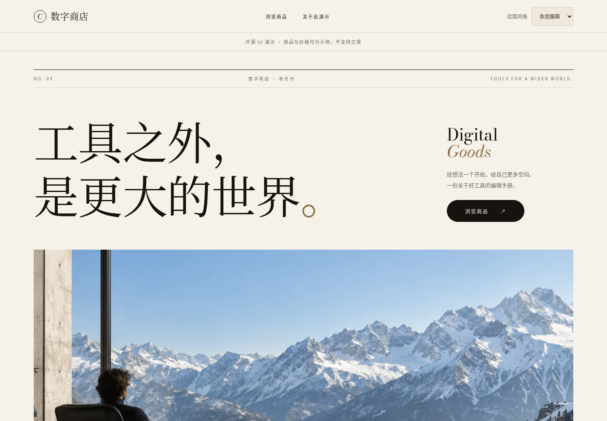
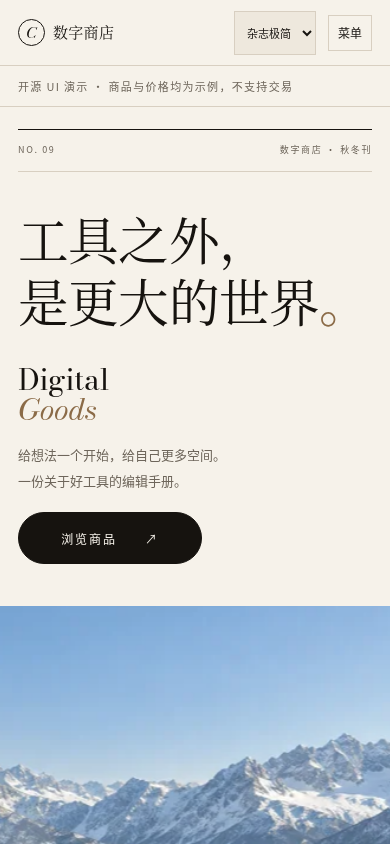

# Coco9 Storefront UI · 六套店面模板

六套可直接预览、可自由修改的数字商品商店 UI。使用原生 HTML / CSS / JavaScript，无框架、无运行时依赖，采用 MIT 许可。

**先看效果：下载 [preview.html 单文件预览](https://github.com/lincwang123-bot/coco9-storefront-ui/raw/refs/heads/main/preview.html)，保存后用浏览器打开。** 六套模板、图片和交互都已内嵌，不用安装软件，也不用启动服务器。

另有 **[电脑真 3D 独立预览](https://github.com/lincwang123-bot/coco9-storefront-ui/raw/refs/heads/main/experiments/laptop-3d/laptop-3d.html)**：支持静止 3 秒后缓慢自动旋转、拖动、缩放、屏幕开合与金属配色切换，并加入摄影棚光照与屏幕玻璃反射。使用 Three.js，下载后可离线打开；[使用与修改说明](experiments/laptop-3d/README.md)。它是独立实验，不会改变上面的六模板预览。

> 这是前端 UI 和演示商品，不是完整的电商系统。真实商品、用户、订单与支付需要连接你自己的后端。

## 只想先看一看：下载 HTML 就能用

1. 点击上方 **preview.html 单文件预览** 并保存到电脑。如果浏览器显示源代码，使用“另存为”，文件名保留 `preview.html`，不要存成 `.txt`。也可以从仓库的 **Code → Download ZIP** 下载完整项目后解压。
2. 双击 `preview.html`，或把它拖入 Chrome、Edge、Safari 等现代浏览器。
3. 点击六张模板缩略图切换风格。点击 **桌面 / 手机** 查看 1440 px / 390 px 布局；预览区域内可以滚动。
4. 试用搜索、分类与商品详情。内容和价格是演示数据，不会下单或扣款。

这个文件可以单独复制、发给同事或离线打开，不需要旁边再放图片文件夹。需要修改源码时，请使用后面的“开发与修改”流程；不要直接编辑生成后的大 HTML。

## 六套样例全部展示

以下截图均来自实际运行的演示页面。每套都包含独立主视觉、布局和移动端适配。

### 极简旗舰

真白与纯黑，适合干净、克制的数字工具商店。 设计标识：`minimal`；兼容 ID：`minimal`。


<details>
<summary>展开查看极简旗舰手机样例</summary>


</details>

### 暗黑科技

地球弧面、冰蓝辉光和大搜索框，适合科技与效率工具。 设计标识：`orbital`；兼容 ID：`dark-business`。


<details>
<summary>展开查看暗黑科技手机样例</summary>


</details>

### 生活方式

暖阳工作桌、手写标题与陶土色，适合温暖的创作与生活品牌。 设计标识：`warm`；兼容 ID：`card-catalog`。


<details>
<summary>展开查看生活方式手机样例</summary>


</details>

### 游戏像素

原创像素世界和游戏招牌，商品采用道具式陈列。 设计标识：`arcade`；兼容 ID：`compact-list`。


<details>
<summary>展开查看游戏像素手机样例</summary>


</details>

### 杂志极简

衬线大标题、象牙白留白与细线分隔，配合开场动画、逐字浮现、幕布式图片展开、横向滚动精选、悬停跟随光标等动效，适合追求高级感的品牌。系统开启“减少动态效果”时自动显示静态版本。 设计标识：`editorial`；兼容 ID：`editorial`。



<details>
<summary>展开查看杂志极简手机样例</summary>



</details>

### 赛博霓虹

原创动漫人物、紫青城市和细霓虹边线，适合醒目的创作工具商店。 设计标识：`neon`；兼容 ID：`playful`。


<details>
<summary>展开查看赛博霓虹手机样例</summary>


</details>

## 开发与修改：下载源码后运行

### 1. 获取完整项目

在仓库页面点击 **Code → Download ZIP**，下载并解压。也可以使用 Git：

```sh
git clone https://github.com/lincwang123-bot/coco9-storefront-ui.git
cd coco9-storefront-ui
```

ZIP 下载用户：在解压后的项目目录打开终端。确认当前目录能看到 `package.json`。

### 2. 启动演示

安装 Node.js 20 或以上版本，然后执行：

```sh
npm start
```

浏览器打开 **http://127.0.0.1:5173**，右上角选择主题。无需运行 `npm install`。使用完毕，在终端按 **Ctrl+C** 停止服务。

如果 5173 端口被占用，可以指定其他端口：

```sh
# macOS / Linux
PORT=5180 npm start
```

```powershell
# Windows PowerShell
$env:PORT=5180; npm start
```

随后打开 `http://127.0.0.1:5180`。

### 3. 按需要修改

| 想修改什么 | 修改位置 | 说明 |
| --- | --- | --- |
| 店名、页头、页脚 | `index.html` | 普通 HTML 文本；像素与杂志模板内的店名另见 `demo.js` 的 `brand` |
| 演示商品、价格、分类 | `demo.js` | 修改 `products`、`categories` 数组 |
| 首页标题、文案与布局 | `src/themes/*.js` | 每套模板一个独立文件 |
| 颜色、字号、卡片与响应式布局 | `src/styles.css` | 通过 `body[data-design="..."]` 区分模板 |
| 演示页基础样式 | `demo.css` | 页头、基础控件、演示说明等 |
| 主视觉图片 | `src/assets/` | 每套保留 `-768.webp` 与 `-1536.webp` 两个尺寸 |
| 主题名称与说明 | `src/registry.js` | 若已用于真实业务，不要随意改已有 `id` |
| 离线预览页的外框 | `preview/` | 缩略图、桌面/手机切换和使用说明 |

修改后刷新浏览器。若要分享更新后的离线 HTML，再执行：

```sh
npm run build:preview
```

它会根据当前模板源码、`index.html`、`demo.js`、样式和图片重新生成根目录的 `preview.html`。此构建命令只需 Node.js，不安装额外依赖。离线预览的数据也来自 `demo.js`；样式切换控件使用外层的六张缩略图。

## 接到自己的项目

可以直接修改完整演示，也可以把 `src/` 复制到自己的前端。现有页面需引入样式并提供容器：

```html
<link rel="stylesheet" href="./demo.css">
<body class="storefront">
  <main id="main"></main>
  <script type="module" src="./your-store.js"></script>
</body>
```

`demo.css` 会加载 `src/styles.css` 并提供基础规则。若已有自己的基础样式，也可以只引入 `src/styles.css`。

在 `your-store.js` 中渲染店面与商品：

```js
import {renderStorefront, renderProduct, themeFor, bindLaptop} from './src/index.js';

// 可传设计标识 orbital，也可传兼容 ID dark-business。
const theme = themeFor('orbital');
const main = document.querySelector('#main');
document.body.dataset.design = theme.design;
document.body.dataset.template = theme.id;

main.innerHTML = renderStorefront({
  template: theme.id,
  brand: '你的店名',
  categories: [{id: 'tools', name: '数字工具'}],
  assetBase: './src/assets',
  // heroTitle: '你的首页标题\n可在这里换行',
});

main.querySelector('.products').innerHTML = renderProduct({
  name: '你的商品',
  category: '数字工具',
  description: '来自你的商品接口的说明',
  price: '20.00 USDT',
  image: '/images/product.webp',
  href: '#/product/your-product',
  soldOut: false,
}, theme.id);

// 极简旗舰的电脑支持鼠标跟随、拖动、方向键与复位；其他模板无需处理。
const disposeLaptop = bindLaptop(main);
// 替换 main 内容或离开页面前调用 disposeLaptop()，释放事件与待绘制帧。
```

这个示例负责渲染。继续参考 `demo.js`，为 `.search`、`data-category`、`data-catalog-jump` 和商品链接绑定搜索、分类、滚动与路由；移动菜单接线方式见 `src/navigation.js`。如已有路由系统，在适配层将 `#/product/...` 映射到你的商品详情页。

极简旗舰的电脑使用原图的有限角度视差，并非可以查看背面的 360° 模型。手机左右滑动可调整视角，上下滑动仍滚动页面；点击“复位”恢复。键盘方向键可调整，Esc、Home 或 Enter 可复位；系统开启“减少动态效果”时显示静态图片。交互使用 CSS 和按需更新，无持续动画循环或 WebGL 依赖。

商品名称、说明、价格与分类文本会转义。商品图片接受站内绝对路径或 HTTPS 地址。`src/` 本身不请求 API、不保存账户凭证、不处理支付；结算金额、库存、权限与订单状态应由你的服务端校验。

### 六套主题的准确标识

以下标识是代码值，请原样复制。浏览器若开启自动翻译，请勿使用翻译后的中文代替。

| 风格 | 设计标识 | 兼容 ID |
| --- | --- | --- |
| 极简旗舰 | `minimal` | `minimal` |
| 暗黑科技 | `orbital` | `dark-business` |
| 生活方式 | `warm` | `card-catalog` |
| 游戏像素 | `arcade` | `compact-list` |
| 杂志极简 | `editorial` | `editorial` |
| 赛博霓虹 | `neon` | `playful` |

## 部署与常见问题

- **只发布杂志极简一套（锁定风格）**：执行 `npm run build:site`，会生成 `dist/fujisawa-editorial/`。把这个文件夹里的全部内容作为网站根目录上传即可（含 Cloudflare 可识别的 `_headers`）。换成其他风格：`node scripts/build-site.mjs <设计标识> dist/<目录名>`。
- **把演示发布到网上**：将 `index.html`、`demo.css`、`demo.js`、`favicon.svg` 和完整 `src/` 目录上传到静态托管服务，保持目录结构。这里无需运行 Node.js 服务。单文件 `preview.html` 也可独立静态托管。
- **想开始真实销售**：还需接入自己的商品、账户、订单与支付系统。发布此 UI 并不会自动获得这些功能。
- **双击 `index.html` 后页面空白**：开发版使用 ES Modules，需要通过 `npm start` 打开。双击预览请使用 `preview.html`。
- **修改源码后 `preview.html` 没变化**：重新执行 `npm run build:preview`，然后刷新该文件。
- **新图片不显示**：核对文件名、扩展名、目录和 `assetBase`；保留对应的两个 WebP 尺寸，或同步修改 `src/shared.js` 中的图片生成逻辑。
- **离线 HTML 的桌面视图看起来偏小**：它会把完整 1440 px 页面缩放到当前窗口；放大浏览器窗口可看得更清楚，或切到手机视图。

## 检查与许可

```sh
npm test
npm run build:preview
```

`npm test` 检查主题兼容、输入转义与安全链接。页面包含表单标签、可见键盘焦点、原生详情弹窗，并尊重 `prefers-reduced-motion`。

代码采用 [MIT License](LICENSE)。主视觉是原创 AI 生成素材，来源、生成提示词和权利边界见 [ASSETS.md](src/ASSETS.md)。第三方商标权不在授权范围内。仓库不含生产后端、账户、密钥、数据库、订单或卡密。
